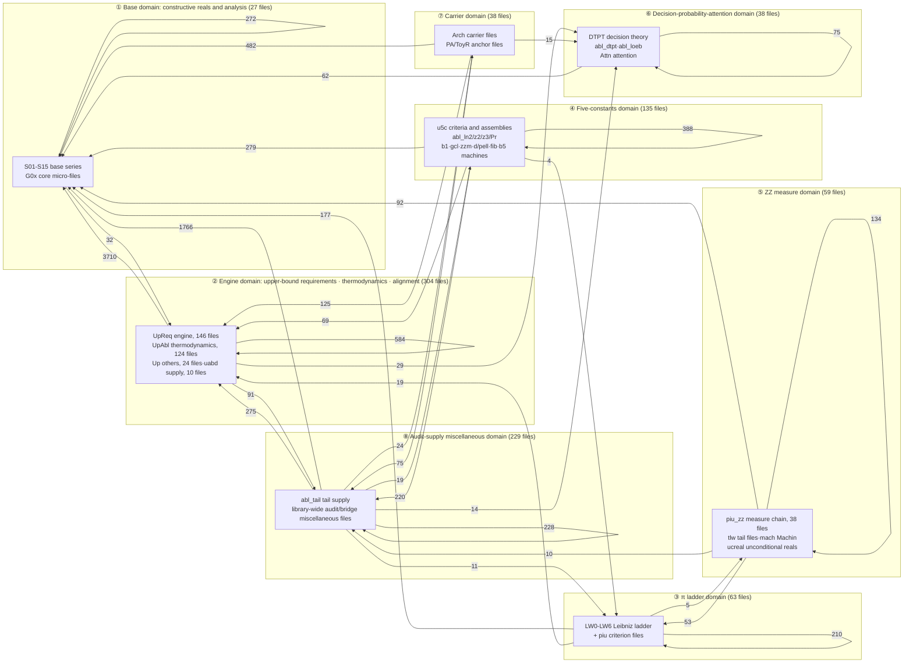
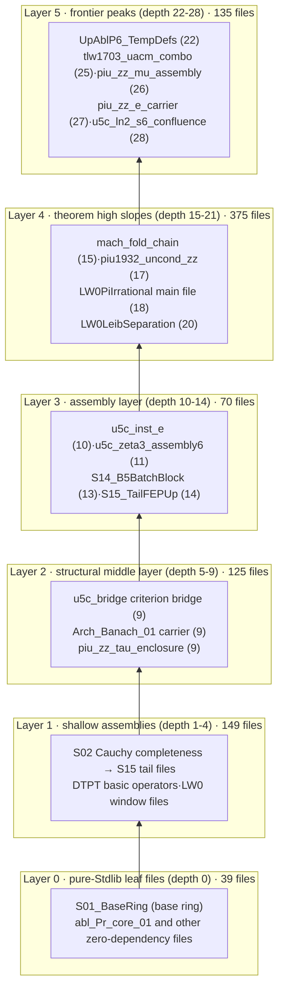
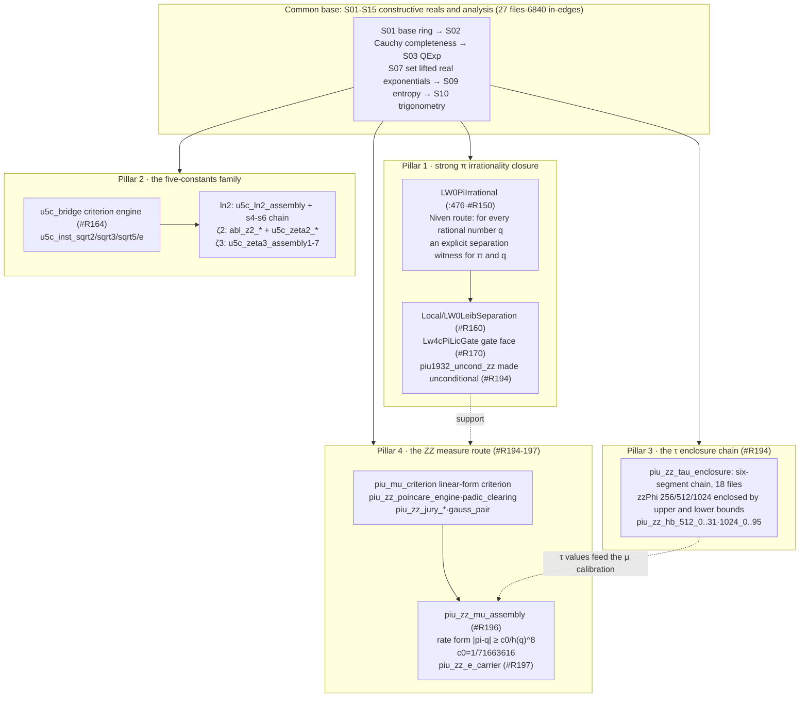
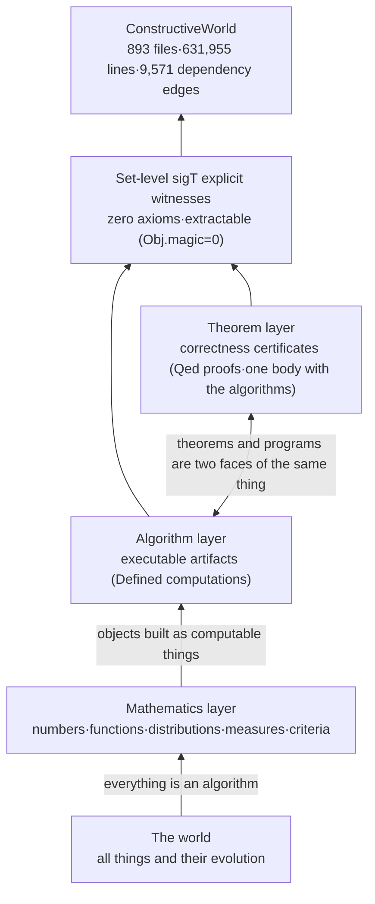

# ConstructiveWorld Architecture (ARCHITECTURE)

**Data baseline day: 2026-10-28** (all figures are values measured on that day against the `ConstructiveWorld_Live/` working tree; the statistical basis and the re-computation command forms are given in Appendices A/B. This document was generated from read-only verification: it modifies no source file, no registration surface, and no build artifact.)

---

## 0. The philosophical layer: construct everything constructible

The thesis of this library can be stated in one sentence: **construct everything constructible**. It is not a proof repository built around a single theorem but a systematic attempt to construct, layer by layer, all things in the world as computable objects. Its methodological conviction is that **the essence of the world is algorithmic**: algorithms are universal and are not the monopoly of computers or artificial intelligence — the evolution of every thing proceeds according to algorithms, and algorithms carry the underlying structure of the world, covering the operating laws of all things. Transplanting this conviction into the foundations of mathematics yields the way this library is constructed:

> Every `.v` file is an attempt to construct a piece of the world (a number, a function, a distribution, a measure criterion) as a computable object in type theory. Existence does not mean "assuming that it exists"; it means **producing a witness**: the whole library states existential conclusions through explicit `sigT` witnesses at the `Set` level of Rocq/Coq and introduces no axioms (per the `coqchk -o` basis: `Axioms: <none>`).

The library README puts this precisely: "**theorems and programs are two faces of the same thing**" — executable artifacts (`Defined` computations) and their correctness certificates (`Qed` proofs) coexist in one body, a paradigm referred to in-library as computational content (extractable computational content). This is exactly the type-theoretic realization of the thesis "everything is an algorithm": when a mathematical object is given constructively, the theorem about it is simultaneously the program that produces it. The whole library can be extracted to target-language code via `Separate Extraction`, with a mechanical check that the `Obj.magic` count is zero — that is, **no content leaks from the propositional layer into the algorithmic layer**; the purity of the construction is mechanically auditable.

Starting from its rational-number foundation, the library constructs layer by layer the reals, analysis, probability, information theory, decision theory and reinforcement-learning alignment, trigonometric functions and π, irrationality criteria and irrationality measures — a construction tower "from arithmetic to the world" (Figure ⑤).

---

## 1. Library-wide overview (measured 2026-10-28)

| Metric | Value | Basis |
|---|---|---|
| Total `.v` source files | **893** | root 892 + `Local/` 1 |
| Total source lines | **631,955** | root 626,232 + `Local/` 5,723 |
| Registered files (registration order) | **844** | `order.txt` has 844 lines; line order is the compile-time dependency order |
| Registration batch-number span | `#R0` → `#R197` (74 batch numbers, **non-contiguous**) | batch numbers are cumulative, not sequential |
| Source files outside the register | **49** (including the probe file `_twc_probe.v`) | `.v` files present in the tree but not listed in `order.txt` |
| Total `Require` tokens | 17,612 | module tokens on the `Require`/`From … Require` lines of all `.v` files |
| Internal dependency tokens (pointing into the library) | 11,403 | tokens that match an in-tree `.v` file name |
| Stdlib dependency tokens | 6,209 | pointing at `QArith`/`Arith`/`Lia`/`List` and the like |
| Internal file-level dependency edges after deduplication | **9,571** | directed edges "file → the library file it Requires", deduplicated |
| Extraction artifacts | 177 each of `.ml`/`.mli` in the root directory | on-disk audit targets of the `Separate Extraction` surface |
| Files directly requiring one of the two base files | 734 / 893 files | `Require S01_BaseRing` or `S02_CauchyComplete` |

**Dual-tree layout**: `ConstructiveWorld_Live/` (the source tree, containing `order.txt` and `_CoqProject`, with the `-Q . ""` flat namespace) and `ConstructiveWorld_vo/` (the artifact tree, also holding `.vo`/`.glob` etc.). At the root level there are also `CLA/` (contributor license agreements), `docs/` (where this document lives), `releases/` (the historical single-file merged release, version 220), `scripts/` (registration-order maintenance and CI sentinels), `attn/` (historical work records), and `Makefile`/`build.sh` (build entry points).

---

## 2. Atlas of figures

### Figure ① The full-domain map (domain map)

Nodes = the **eight mathematical domains** aggregated from module families; edges = measured inter-domain dependency edges (deduplicated at file level and labeled with edge counts; only the 31 main flows with ≥50 are drawn). How to read it: **the base domain is the absolute sink of dependency** (6,840 in-edges, 71.5% of the whole library); the engine domain is the largest dependency emitter (4,414 out-edges).



Legend: node annotations give the main file families and file counts within each domain; edge labels give deduplicated file-level dependency edge counts (measured 2026-10-28; basis in Appendix A.3). A further 18 low-flow edges with <10 are not drawn (PI→ZZ, FIVE→PI and the like are drawn; the six back edges and terminal flows totaling 7 edges — S_base→MISC 2, S_base→DECISION 1, PI→DECISION 1, DECISION→ENGINE 1, DECISION→CARRIER 1, CARRIER→CARRIER 1 — are omitted; full table in §5.2).

### Figure ② Layered dependency topology (layered topology)

The layering basis is **require-chain depth**: `depth(f)=0` if f Requires no library file, otherwise `depth(f)=1+max(depth of the required files)` (the longest chain; re-computation command in Appendix A.4). The maximum depth in the library is **28** (`u5c_ln2_s6_confluence.v`).



Legend: node labels give representative file names of each layer (transcribed verbatim) + the measured depth. Distribution: 39 files at depth 0; 149 files at depths 1-4; 125 files at depths 5-9; 70 files at depths 10-14; 375 files at depths 15-21; 135 files at depths 22-28. Reverse statistic: **423 files are not Required by any library file** (the consumption top of the tree).

### Figure ③ Registration evolution timeline (growth timeline)

The batch-number sequence of the registration order `order.txt` (#R0 through #R197; 74 batch numbers · 844 files) clusters by theme into ten waves. The batch numbers are non-contiguous (gaps such as #R1-R100): they are cumulative numbers.

```mermaid
graph LR
  E0["#R0 baseline import<br/>359 files<br/>S01-S15 base·G core·DTPT<br/>Attn·UpAbl/UpReq first batch·Arch·PA"]
  E1["#R101-132 engine and thermodynamics<br/>58 files<br/>UpAblP6 thermalization·UpReq criteria<br/>Arch·PA anchor expansion"]
  E2["#R133-139 audit waves and<br/>the birth of the π ladder<br/>59 files<br/>abl audits, 45 files·#R137<br/>LW0-LW6 ladder, 20 files"]
  E3["#R141-152 main files registered<br/>32 files<br/>LW tail segments·#R150<br/>LW0PiIrrational:476"]
  E4["#R153-160 major audit waves<br/>123 files<br/>#R157 single wave, 61 files·ln2·loeb<br/>#R160 Local separation file"]
  E5["#R161-171 birth of the five constants<br/>39 files<br/>#R164 u5c bridge·√2√3e<br/>#R167 ζ2·#R171 √5"]
  E6["#R172-179 tail gates and<br/>Machin<br/>21 files<br/>tlw gates·mach identities<br/>ucreal unconditional"]
  E7["#R181-189 five-constants expansion<br/>94 files<br/>ζ3 assembly 1-5·ln2 s4-s6<br/>d/pell number families"]
  E8["#R190-193 Gaussian machines<br/>18 files<br/>gcl·zzm·zb3·fib·d41"]
  E9["#R194-197 ZZ measure route<br/>41 files<br/>#R194: 38 files, τ enclosure chain<br/>#R196 μ assembly·#R197 e carrier"]
  E0 --> E1 --> E2 --> E3 --> E4 --> E5 --> E6 --> E7 --> E8 --> E9
```



Legend: the top line of each node gives the batch range and theme, the middle line the file count (measured sum = 844), and the bottom line the representative content of that wave. The growth pattern is "**one-shot baseline import → main-file registration → alternating audit/assembly waves → a narrowing frontier**": the #R0 baseline accounts for 42.5% of the library, and the subsequent single-wave peaks #R157 (61 files) and #R194 (38 files) correspond to the audit-assembly waves and the τ enclosure chain effort, respectively.

### Figure ④ The four pillars (certified construction outcomes)

Drawn from the current state of the library README §1-2 and the file names measured in the tree. All four pillars stand on the common base (① base domain).



Legend: solid lines = measured Require lineage direction; dashed lines = support relations among the results (based on README §1-2 and file-header notes). Certification status: library version `8df6c9f` (2026-10-26); local dual-line `coqchk` ALL_PASS with `Axioms: <none>`; CI certification in progress (README §2, verbatim). The π main file sits at registration order :476 (checked, consistent with the measurement).

### Figure ⑤ The construction tower (philosophical narrative overview)

The type-theoretic realization path of the thesis "everything is an algorithm": the world is translated layer by layer into algorithms, and the algorithms are constructed layer by layer into computable objects at the `Set` level.



Legend: bottom-up is the direction of construction; the tower body is this library, its base the rational-number foundation (S01-S03), and its apex the current frontier of the ZZ measure route (#R197).

---

## 3. Domain profiles

The eight subsections below correspond to the eight domains of Figure ①. File counts and line counts are as measured on 2026-10-28; representative file names are transcribed verbatim from the tree; the mission paragraphs are excerpt-translations of the mission/Mission notes in each file header.

### 3.1 Base domain — constructive reals and analysis (27 files · 134,677 lines)

The foundation of the library and its common dependency sink: 6,840 in-edges (71.5% of the whole library). `S01_BaseRing.v` lays down the real-number interface, the three classes of indexing (interface fields / Section Variables / proven theorems), and the basic algebraic-order lemmas, and fixes the discipline that "the custom Id equality on the R layer is handled by explicit id_trans/id_cong chains, with no ad-hoc axiom surface"; `S02_CauchyComplete.v` supplies the Cauchy-complete real core; `S03_QExp.v` provides rational powers and factorials; `S07_RealSetoidExpLog.v` carries the real-layer exponential and logarithm; `S09_EntropyReal.v` constructs the real-layer entropy and the Boltzmann distribution (the KL decomposition and the Gibbs identity); `S10_KVQuantTrig.v` provides the trigonometric surface (`cauchy_real_sin`/`real_pi_geom`). The twelve `G0x_core_micro` files are core micro-modules (for example, the free-energy minimization uniqueness and the two-copy enumeration counterexample of `G01_CoreMicro.v`).

Representative files: `S01_BaseRing.v`, `S02_CauchyComplete.v`, `S03_QExp.v`, `S09_EntropyReal.v`, `S10_KVQuantTrig.v`, `S14_B5BatchBlock.v` (a 13,000+ line batch block), `G01_CoreMicro.v`. Certification status: all registered (the #R0 baseline; S11/S12/S14 re-registered at #R153).

### 3.2 Engine domain — upper-bound requirements · thermodynamics · alignment (304 files · 195,838 lines)

The largest domain of the library and its largest dependency emitter (4,414 out-edges, of which 3,710 land directly in the base domain). `UpReq_*` (146 files · 123,886 lines) is the "upward requirement" engine: Padé approximation tail terms, alternating-sum engines, the Banach-norm and binomial surfaces, irrationality criteria (`lic_irrational_criterion` of `UpReqIrrationalCriterion.v` is the parent criterion of the five-constants family), entropy monotonicity, thermal duality, and more. `UpAbl_*` (124 files · 47,001 lines) are the thermodynamic assembly modules: `UpAblP6_TempDefs.v` thermalizes Boltzmann on a single-point summation carrier (partition function / thermalized distribution / energy expectation / explicit entropy formula, all formalized at the Set level), extending to instances for the second law of thermodynamics and for the attention and GRPO/DPO alignment surfaces. The 24 `Up_other` files and the 10 `uabd_supply` files are the domain's supply and discharge modules.

Representative files: `UpReqPadeTailPos.v`, `UpReqIrrationalCriterion.v`, `UpAblP6_TempDefs.v`, `UpAblMetaEngine.v`, `uabl_attn_full_instance.v`. Certification status: the main body is registered (the domain has a further 39 files in the outside-the-register difference set; see §6).

### 3.3 The π ladder domain (63 files · 40,423 lines)

The backbone of the first pillar. `LW0-LW6` (LW = the Leibniz window route) are erected level by level from `LW0LeibWindow.v` (38 files from #R137 on): differential algebra, carriers, alternating sums, and counting bounds, up to the main file `LW0PiIrrational.v` (#R150 · registration order :476 · depth 18) — "for every rational number q, an explicit separation witness between π and q" — the technical route being an algebraization of the Niven-type integral argument (the file header records the reference I. Niven, Bull. Amer. Math. Soc. 53 (1947), and notes that "the Coq standard library has no counterpart"). `Local/LW0LeibSeparation.v` (#R160 · depth 20 · 5,723 lines) supplies the strong separation surface; `Lw4cPiLicGate`/`Lw4cPiLicFaceNonempty` (#R170) are the gate and face modules; `piu_leibsep` (17 files, #R181-193) and `piu1932_uncond_zz` (#R194) continue to push toward unconditional statements and tighter windows.

Representative files: `LW0PiIrrational.v`, `LW0LeibWindow.v`, `Local/LW0LeibSeparation.v`, `Lw4cPiLicGate.v`, `piu1932_uncond_zz.v`. Certification status: the main file is registered · local coqchk all green (README §2).

### 3.4 The five-constants domain (135 files · 59,961 lines)

The second pillar: the constructive irrationality-separation file families for √2, √3, √5, e, and ln 2, and the ζ(2) and ζ(3) directions. `u5c_bridge.v` (#R164) lifts the escape point of the parent criterion `lic_irrational_criterion` into an explicit parameter (file header: tail control, escape window, and vanishing window width — three roles in one module); `u5c_inst_sqrt2/sqrt3/sqrt5/e` (#R164/#R171) instantiate it one by one; the ln 2 direction has `u5c_ln2_assembly` with the six-segment s4-s6 chain (#R185/#R188, in which `u5c_ln2_s6_confluence.v` is the **deepest file in the library**, depth 28) together with the 22 `abl_ln2_*` files; ζ(2) goes through mechanized files of the Beukers method (`abl_z2_*`, 7 files · #R167: divisibility / decay / counting, plus the `u5c_zeta2_*` assemblies); ζ(3) has the `u5c_zeta3_assembly` 1-7 assembly chain (#R186-193). Auxiliary mechanized surface: the prime domain `abl_Pr_*` (trial-division primality / least prime factor / the existence form of factorization), the `b1_*` Beukers kernels, the `gcl_*` Gaussian coefficient chain, `zzm1_gauss`/`zb3*`, the `d3/d6/d13/d14/d41/d7/pell` number families, `fib_machine`, and `b5_machine`.

Representative files: `u5c_bridge.v`, `u5c_inst_e.v`, `u5c_ln2_s6_confluence.v`, `u5c_zeta3_assembly6.v`, `abl_z2_itg_carrier.v`, `abl_Pr_core_01.v`. Certification status: the √2/√3/e/ln2 separation files are registered in batches (README §1: from #R164 on); the ζ(2) closed-form theorem assembly is in progress (as registered verbatim in the README).

### 3.5 The ZZ measure domain (59 files · 40,587 lines)

The frontier domain hosting the third and fourth pillars. The 38-file #R194 wave completed the τ enclosure chain: the original 24,636-line monolithic file `piu_zz_tau_enclosure.v` was mechanically split and registered as a six-segment chain of 18 files (head/bank1-4/base/literals/phi1024_slim/hb_wave1-8); 128 anonymous assert blocks were promoted to the standalone lemmas `piu_zz_hb_512_0..31`/`piu_zz_hb_1024_0..95`; and the zzPhi 256/512/1024 literal-value chains are enclosed between upper and lower bounds (`piu_zz_tau_enclosure_head.v` header: statement layer byte-for-byte equivalent, zero hypotheses and zero axioms). The measure route: `piu_mu_criterion.v` gives a linear-form irrationality-measure criterion (a q^(−μ) approximation lower-bound form with μ(x) ≤ 1+σ/τ); `piu_zz_poincare_engine`/`piu_zz_padic_clearing`/`piu_zz_jury_*` provide the engine surface; `piu_zz_mu_assembly` (#R196) assembles the rate-form certificate **|π−q| ≥ c0/h(q)^8 (c0=1/71663616, h(q)=1+ the denominator of q)**; and `piu_zz_e_carrier` (#R197 · the newest file in the tree) carries the E-side carrier and the conditional μ certificate chain. The domain also contains the 13 `tlw_*` files (tail gates and the Padé surface), the 3 `mach_*` files (series folding of the J. Machin 1706 identity), and the 5 `ucreal_*`/`uacm` files (the unconditional separation surface).

Representative files: `piu_zz_tau_enclosure.v`, `piu_zz_tau_enclosure_head.v`, `piu_mu_criterion.v`, `piu_zz_mu_assembly.v`, `piu_zz_e_carrier.v`, `mach_fold_chain.v`, `tlw1703_uacm_combo_unconditional.v`. Certification status: the #R194 wave is registered · local coqchk ALL_PASS with 4 parallel groups (README §5).

### 3.6 The decision-probability-attention domain (38 files · 28,844 lines)

The domain that constructs probability and decision theory as Set-level objects. `DTPT_*` (10 files, 14,919 lines): `DTPT.v` carries the basic operators insert_q/P0/rot/interleave, the deduplication family, permutation invariance, the entropy surface, the frequency-measure layer, and the frequency-entropy algebra; `DTPT_Bridge_Dep.v` is the Set-form certificate layer for the treatment of identity clusters (spot checks over eight clusters + eight closed-form numerical anchors + per-file Extract). `Attn_*` (4 files): `AttnDoeblin.v` constructs a Doeblin bound for the attention chain from two-point total-variation contraction. The 18 `abl_dtpt_*` files supply the decision-theory bridging (the dig/truth/yellow/rot bridges), and the 6 `abl_loeb_*` files are Loeb-type constructions.

Representative files: `DTPT.v`, `DTPT_Bridge_Dep.v`, `AttnDoeblin.v`, `abl_loeb_d3.v`. Certification status: the main body is registered (the #R0 baseline + #R153/#R154 supplements).

### 3.7 The carrier domain (38 files · 31,551 lines)

The surface for collecting proposition families and carrying their instantiation. `Arch_*` (18 files; for example `Arch_Banach_01.v`: the collected compilation of the bnhn/bxcb proposition families with their instantiation carrier, the header noting "the whole file closes with Qed, zero admission tokens, and the statement layer is carried at the Set level with zero Prop leakage"); `PA_*`/`ToyR_*` (20 files) are the paper anchor files and ToyR slices (`ToyR_fa56b_ext.v` and the like), many of them same-name replacement drafts — rebuilds in which the statement layer is untouched and only the verification proof core is replaced (the carrier form of the working mode recorded in the `S01_BaseRing.v` header).

Representative files: `Arch_Banach_01.v`, `Arch_PA_01.v`, `PA_DTPT_Bridge_Dep.v`, `ToyR_EntropyMonoSplitInst.v`. Certification status: registered in batches (#R113/#R116/#R161).

### 3.8 The audit-supply miscellaneous domain (229 files · 100,074 lines)

The library's engineering-grade immune system. `abl_tail_*`/`abl9*`/`ablt9*`/`abl_tbase_*` (40 files) are the supply modules for tail-hundred assumption discharge: they supply non-trivial proofs in bulk for the interface assumptions of the library's tail modules (for example `abl_tail_supply_65..70`, `abl_tbase_zapfeed`). The remaining 189 miscellaneous files cover: the thermodynamics-KL cluster (`RealKLDecomp.v`, `PinskerTwoPoint.v`, `SecondLawQuantified.v`, `FreeEnergyKLGap.v`, about 31 files), the π support cluster (`BeukersIdentity.v`, `Ln2Escape.v`, `PiEnvelope.v`, `PadeErrorIntegral.v`, about 15 files), the real-number tools cluster (`AbsLeId.v`, `DenPosGeneral.v`, about 36 files), and the remaining single files. The cluster boundaries are drawn by file-name keywords and are an approximate accounting (Appendix A.5).

Representative files: `abl_tail_supply_70.v`, `abl_tbase_zapfeed.v`, `RealKLDecomp.v`, `SumInvFactEscape.v` (closing the Σ1/k! escape target). Certification status: the main body is registered in the #R133-157 twin audit waves.

---

## 4. Family statistics table (31 families · measured 2026-10-28)

A family = a semantic family of file-name prefixes; line counts are `.v` source-file line counts. Sorted by line count, descending.

| Family | Mission summary | Files | Lines |
|---|---|---:|---:|
| UpReq_engine | Upper-bound requirement engine (Padé tail terms / criteria / entropy / duality) | 146 | 123,886 |
| S01-S15_base | Constructive real-number and analysis base | 15 | 114,626 |
| ZZ_misc_single | Library-wide audit/bridge/tool miscellaneous files | 189 | 82,850 |
| UpAbl_thermo | Thermalized thermodynamics and alignment assembly files | 124 | 47,001 |
| piu_zz_measure | τ enclosure chain and irrationality-measure chain | 38 | 34,075 |
| LW_pi_ladder | Leibniz-window π ladder (including the Local separation file, 5,723 lines) | 46 | 34,410 |
| Arch_carrier | Collected proposition families and instantiation carriers | 18 | 24,910 |
| u5c_five_const | Five-constants criterion engine and instance assemblies | 53 | 24,133 |
| Up_other | Remaining assembly files of the Up domain | 24 | 23,821 |
| G_core_micro | Core micro-files (free energy / entropy laws / counterexamples) | 12 | 20,051 |
| abl_tail_tbase | Tail assumption discharge supply files | 40 | 17,224 |
| DTPT_decision | Decision-theory basic operators and certificate layer | 10 | 14,919 |
| abl_ln2_lnT | ln2 assemblies and machine bridges | 22 | 11,290 |
| abl_dtpt | Decision-theory bridging supply | 18 | 8,295 |
| PA_ToyR_anchor | Paper anchor files and ToyR slices | 20 | 6,641 |
| abl_Pr_primes | The file set forming the prime domain | 14 | 6,357 |
| piu_leibsep | π separation-criterion advancement files | 17 | 6,013 |
| abl_z2_zeta2 | ζ(2) Beukers mechanization files | 7 | 3,997 |
| gcl_gauss | Gaussian coefficient chain | 7 | 3,767 |
| tlw_tail | Tail gates and the Padé surface | 13 | 3,173 |
| abl_loeb | Loeb-type construction files | 6 | 2,818 |
| Attn_attention | Attention Doeblin/square-root bounds | 4 | 2,812 |
| d_pell_families | d3/d6/d7/d13/d14/d41/pell number families | 7 | 2,694 |
| zz_gauss_machine | Gaussian linear-form machines (zzm/zb3/zz) | 9 | 2,311 |
| mach_machin | Machin identity series machines | 3 | 2,210 |
| abl_z3_zeta3 | ζ(3) decay/counting mechanization files | 5 | 1,940 |
| b1_beukers | Beukers kernel machines (b1_*) | 7 | 1,512 |
| uabd_supply | Up-domain assumption discharge supply | 10 | 1,130 |
| ucreal_uncond | Unconditionally constructed real-number separation surface | 5 | 1,129 |
| b5_machine | b5 counting machine | 1 | 1,056 |
| fib_machine | Fibonacci mechanization files | 3 | 904 |
| **Total** | | **893** | **631,955** |

---

## 5. Dependency-edge statistics (measured 2026-10-28)

### 5.1 Per-domain in- and out-degrees

| Domain | Files | Lines | In-edges | Out-edges |
|---|---:|---:|---:|---:|
| Base (S01-S15 + G0x) | 27 | 134,677 | **6,840** | 307 |
| Engine (UpReq/UpAbl/Up-other/uabd) | 304 | 195,838 | 1,105 | **4,414** |
| Five constants (u5c + abl_z2/z3/ln2/Pr + b1/gcl/zz/d/pell/fib/b5) | 135 | 59,961 | 407 | 960 |
| π ladder (LW/piu) | 63 | 40,423 | 278 | 427 |
| ZZ measure (piu_zz/tlw/mach/ucreal) | 59 | 40,587 | 139 | 289 |
| Decision-probability-attention (DTPT/abl_dtpt/abl_loeb/Attn) | 38 | 28,844 | 135 | 139 |
| Carrier (Arch/PA/ToyR) | 38 | 31,551 | 26 | 698 |
| Audit-supply miscellaneous (abl_tail + misc) | 229 | 100,074 | 641 | 2,337 |
| **Total** | **893** | **631,955** | **9,571** | **9,571** |

### 5.2 Full table of inter-domain edges (38 pairs · descending by flow)

| Source domain → target domain | Edges | | Source domain → target domain | Edges |
|---|---:|---|---|---:|
| Engine → Base | 3,710 | | Decision → Base | 62 |
| Misc → Base | 1,766 | | ZZ → π ladder | 53 |
| Engine → Engine | 584 | | Base → Engine | 32 |
| Carrier → Base | 482 | | Engine → Decision | 29 |
| Five constants → Five constants | 388 | | Misc → Carrier | 24 |
| Five constants → Base | 279 | | π ladder → Engine | 19 |
| Misc → Engine | 275 | | Misc → Five constants | 19 |
| Base → Base | 272 | | Carrier → Decision | 15 |
| Misc → Misc | 228 | | Misc → Decision | 14 |
| Five constants → Misc | 220 | | Misc → π ladder | 11 |
| π ladder → π ladder | 210 | | ZZ → Misc | 10 |
| π ladder → Base | 177 | | π ladder → ZZ | 5 |
| ZZ → ZZ | 134 | | Five constants → π ladder | 4 |
| Carrier → Engine | 125 | | Base → Misc | 2 |
| ZZ → Base | 92 | | Base → Decision | 1 |
| Engine → Misc | 91 | | π ladder → Decision | 1 |
| Decision → Decision | 75 | | Decision → Engine | 1 |
| Carrier → Misc | 75 | | Decision → Carrier | 1 |
| Five constants → Engine | 69 | | Carrier → Carrier | 1 |

### 5.3 Structural highlights

- **Star-shaped attachment**: of the 9,571 edges, 6,840 (71.5%) point into the base domain; 734/893 files directly Require `S01_BaseRing` or `S02_CauchyComplete`. This is what guarantees the library's "compile order = order.txt line order".
- **A self-cohesive π chain**: the π ladder domain has 210 internal edges, the strongest cohesion of all domains (chained Requires among the LW-series files); outside the domain it reaches mainly down into the base (177).
- **The companion structure of the five constants' mechanized files**: beyond the 388 internal edges of the five-constants domain, it sends 220 edges into the abl miscellaneous domain — the companion consumption relation between the Beukers mechanized files (abl_z2/z3/ln2/Pr) and the u5c assembly surface.
- **A long tail, not a shallow structure**: the require-depth distribution (39/149/125/70/375/135 across the 0/1-4/5-9/10-14/15-21/22-28 layers) shows the library's main body on the depth 15-21 slope; the deepest chain, 28 layers, ends at `u5c_ln2_s6_confluence.v`.

---

## 6. Fail-loud register (where the data disagrees · no forced normalization)

The following ambiguities and drifts surfaced during measurement and are registered one by one:

1. **README registration-count lag**: README §1/§2 states that `order.txt` has 841 lines; the measured count is **844 lines**. The difference of 3 files is `piu1930_domface_negative.v` (#R195), `piu_zz_mu_assembly.v` (#R196), and `piu_zz_e_carrier.v` (#R197) — added after the README was written, and the README was not updated accordingly.
2. **Drift in the outside-the-register count**: README §8 states 45 files (plus 1 probe file `_twc_probe.v`); the measured count of unregistered `.v` files in the tree is **49** (probe included). The README's recorded basis is "to be settled with the public pre-release batches"; this document takes the 2026-10-28 measurement as authoritative.
3. **Naming-basis note**: prior internal registration documents referred to this certificate chain as "the `piu_zz_ec_mu_cond` six-premise chain"; that name has **no corresponding file either in the tree or in the registration order**. As measured, the actual file names of the μ certificate chain are `piu_mu_criterion.v` (criterion) → `piu_zz_mu_assembly.v` (rate-form assembly) → `piu_zz_e_carrier.v` (E-side carrier and conditional μ certificate chain; its header self-describes "from the explicit premise group to the rate-form real-layer certificate"). This document records the verified file names; that name refers to the premise-side theorem chain of Section EC inside `piu_zz_e_carrier.v`, not to a standalone file.
4. **Dual-tree drift**: the `ConstructiveWorld_vo/` root has 5 more `.v` files than the `ConstructiveWorld_Live/` root: `LW3Z2SqSqueeze.v`, `_b1328_probe_bridge.v`, `_probe1460a.v`, `_probe1460f.v`, `_probe1460q.v`. A gate3 cross-tree diff sentinel guards this in CI (README §2); this document registers the day's difference set as measured.
5. **Local-edge accounting**: when `Local/LW0LeibSeparation.v` is Required by other files under its bare name, the file-level matching of this statistics pass (by root name) cannot hit the `Local/` path key, so the depended-on edges of that 1 file fall into the Stdlib bucket; the effect on totals is at most 1 edge, in the direction of undercounting.
6. **Miscellaneous-cluster accounting**: the three miscellaneous clusters of §3.8 (thermodynamics-KL / π support / real-number tools) are an approximate classification by file-name keyword matching, not an exact semantic classification; the family-level statistics of §4 use exact prefix matching.
7. **Stdlib token noise**: trailing comments on Require lines (e.g., `(* ...`) produce a small number of spurious tokens; all of them fall into the Stdlib bucket because they match no in-tree file, and the internal edge set is unaffected.

---

## Appendix A · Statistical basis and re-computation command forms

All commands were run inside `ConstructiveWorld_Live/` (Git Bash; verified by measurement on 2026-10-28).

**A.1 File and line counts**:
```sh
ls *.v Local/*.v | wc -l                 # 893
wc -l *.v Local/*.v | tail -1            # 631955
sed 's/#.*//' order.txt | sort > /tmp/reg.txt
ls *.v | sort > /tmp/tree.txt
comm -13 /tmp/reg.txt /tmp/tree.txt | wc -l   # 49 outside the register
```

**A.2 Batch waves**:
```sh
awk -F'#R' '{split($2,a,"-"); print a[1]}' order.txt | sort -n | uniq -c | sort -k2 -n
```

**A.3 Dependency edges**: for each `.v` file, extract the module tokens of its `Require`/`From X Require` lines; a token that, with `.v` appended, matches an in-tree file name is recorded as an internal edge, otherwise as Stdlib; deduplicating the `(source, target)` pairs yields 9,571 edges. Domain membership follows the prefix-function mapping of the §4 family table.

**A.4 require depth**: `depth(f)=0` (no internal Requires); otherwise, for each edge "f depends on t", iterate the relaxation `depth(f)=max(depth(f), depth(t)+1)` to a fixed point (implemented in awk, capped at 80 iterations; converged at 28 layers as measured).

**A.5 Families and miscellaneous clusters**: families follow the prefix regexes of the §4 table (first-match priority = table order); the three miscellaneous clusters match in order on the keyword lists `KL|Entropy|Boltz|Gibbs|...`, `Pi|Sin|Arctan|Trig|Leib|...`, and `Real|Cauchy|Sqrt|Q|...`.

## Appendix B · Data credibility statement

- Every file name and line number in this document (for example, `LW0PiIrrational.v` at `order.txt` :476) is transcribed verbatim from the tree or output mechanically, with no entries filled in by guesswork; wherever a measurement disagrees with the existing documentation (the README), it is registered in §6 — the existing documents are not modified, and no forced normalization is applied.
- The generation of this document involved zero compilation, zero network access, zero commits, and zero pushes; no file other than this document was written into the repository tree.
